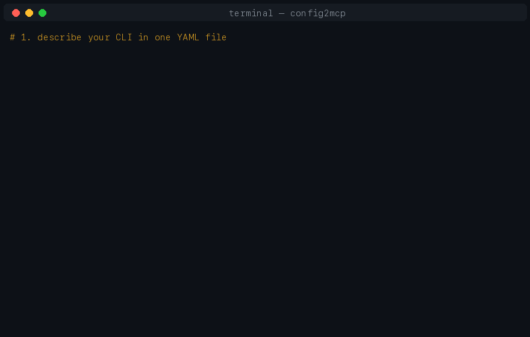

# config2mcp

[](https://github.com/linwanwanwa/config2mcp/actions/workflows/ci.yml)
[](https://www.npmjs.com/package/config2mcp)

**Turn any CLI tool into an MCP server. One YAML file. Zero code.**



```yaml
tools:
  - name: probe
    description: Probe a media file, return JSON metadata
    command: ffprobe
    args: ["-print_format", "json", "-show_format"]
    params:
      - name: input
        positional: true
        type: string
        required: true
```

```bash
npx config2mcp serve ./ffmpeg.yaml
```

That's it — your agent now has a `ffmpeg_probe` tool it can call with a
typed, validated `input` parameter.

## Why

Agents are only as useful as the tools you give them. There are thousands of
battle-tested CLIs (`ffmpeg`, `kubectl`, `pdftk`, `imagemagick`, `git`) that
agents cannot reach, and wrapping each one by hand means writing a full MCP
server every time. **config2mcp makes the wrapper a config file instead of a
project.**

You keep total control over what gets exposed: the YAML *is* your security
policy — if a command isn't in the file, the agent cannot run it.

## Install

```bash
# Use directly (recommended)
npx config2mcp serve ./my-tools.yaml

# Or install globally
npm install -g config2mcp
```

Requires Node 18+.

## Quick start

```bash
# 1. Describe your tool
cat > ./echo.yaml <<'EOF'
tools:
  - name: shout
    description: Print a message in upper case
    command: tr
    args: ["a-z", "A-Z"]
    params:
      - name: message
        positional: true
        type: string
        required: true
EOF

# 2. Check what the agent will see
npx config2mcp inspect ./echo.yaml

# 3. Validate
npx config2mcp validate ./echo.yaml
```

### One-prompt install (let your AI set it up)

Copy the block below, paste it to Claude / Cursor / DSH / any MCP-capable
agent, and it will set everything up for you — package, config, and client
registration. Just tell it which CLI tools you want to expose.

```text
Install the MCP server "config2mcp" for me. Steps:
1. Create a tools config file at ~/.config2mcp/tools.yaml that exposes these CLI tools: <list your commands here, e.g. ffmpeg for media conversion, git for repo status>
2. For each tool write: name (snake_case), a one-line description, the command, its args, and typed params (flag / positional / boolean with trueFlag).
3. Config format reference: https://github.com/linwanwanwa/config2mcp#config-reference — only commands declared in the YAML are reachable (allow-list), keep it read-only if unsure.
4. Validate with: npx -y config2mcp validate ~/.config2mcp/tools.yaml
5. Register the server with your own MCP client config as:
   npx -y config2mcp serve ~/.config2mcp/tools.yaml
6. Tell me which tools got registered and how to test one.
```

### Connect to Claude Desktop

Add to `claude_desktop_config.json`:

```json
{
  "mcpServers": {
    "my-cli-tools": {
      "command": "npx",
      "args": ["-y", "config2mcp", "serve", "/absolute/path/to/echo.yaml"]
    }
  }
}
```

Works the same with any MCP client (Claude Code, Cursor, Windsurf, ...).

## Config reference

| Field | Type | Default | Description |
|---|---|---|---|
| `prefix` | string | — | Tool name prefix, e.g. `ffmpeg` → `ffmpeg_probe` |
| `env` | map | — | Extra env vars for every spawned command |
| `tools` | array | *required* | The tools to expose |

### Tool fields

| Field | Type | Default | Description |
|---|---|---|---|
| `name` | string | *required* | snake_case tool name |
| `description` | string | *required* | What the tool does — the agent reads this |
| `command` | string | *required* | Executable to run (resolved from PATH) |
| `args` | array | `[]` | Literal argv tokens before any params |
| `params` | array | `[]` | Typed parameters (below) |
| `cwd` | string | — | Working directory |
| `timeoutMs` | number | `30000` | Kill the process after this long (max 600000) |
| `jsonOutput` | boolean | `false` | Parse stdout as JSON into structured content |
| `includeStderr` | boolean | `false` | Also return stderr on success |

### Param fields

| Field | Type | Default | Description |
|---|---|---|---|
| `name` | string | *required* | lowerCamelCase parameter name |
| `description` | string | auto | Agent-facing description |
| `type` | `string\|number\|boolean` | `string` | Value type |
| `required` | boolean | `false` | Agent must provide it |
| `flag` | string | — | CLI flag, e.g. `-i` or `--format` |
| `equalsForm` | boolean | `false` | Emit `--flag=value` instead of `--flag value` |
| `trueFlag` | string | — | For booleans: token emitted when true |
| `positional` | boolean | `false` | Pass value as positional arg (in declaration order) |
| `placement` | `global\|local` | `local` | `global` puts the flag right after the executable (e.g. `git -C <path> log`) |
| `enum` | array | — | Allowed string values |
| `default` | string | — | Used when the agent omits the param |

## Docker

```bash
docker build -t config2mcp .
# mount your own config over the bundled safe default
docker run -i --rm -v $PWD/tools.yaml:/config/tools.yaml:ro config2mcp
```

## Trying it safely

Want to see exactly what an agent could run before granting anything?

```bash
config2mcp serve ./ffmpeg.yaml --dry-run
```

Every tool call then answers with the exact argv it *would* have run —
nothing is ever executed. Great for reviewing a config before it goes
anywhere near a real agent.

## Security model

config2mcp is deliberately conservative:

- **No shell, ever.** Commands are spawned directly via `execve`-style APIs —
  every value becomes exactly one argv token, so shell injection is
  structurally impossible.
- **The config is the allow-list.** Only commands in the YAML can run, with
  only the flags you declared. Nothing else is reachable.
- **Bounded by design.** Every command has a timeout (default 30 s) and
  captured output is capped at 256 KiB to protect the agent's context window.
- **Failures are data, not exceptions.** Non-zero exits and timeouts are
  returned to the agent as readable results, so it can react.

You are still responsible for *which* commands you expose: an agent with
access to `rm` can remove files. Expose read-only subcommands (see
[examples/git.yaml](examples/git.yaml) for a deliberately read-only git set).

## Examples

- [examples/ffmpeg.yaml](examples/ffmpeg.yaml) — media probing & conversion
- [examples/git.yaml](examples/git.yaml) — a read-only git window

```bash
npx config2mcp inspect examples/ffmpeg.yaml
```

## Development

```bash
npm install
npm test        # build + unit tests (cross-platform runner)
npm run build   # compile src/ → dist/
node scripts/e2e.mjs   # full MCP protocol test over stdio
```

CI runs the unit suite on a 3-OS × 4-Node matrix and the E2E protocol test
on all three OSes. Pushing a `v*` tag runs the full gate then publishes to
npm and creates a GitHub Release.

## License

MIT
